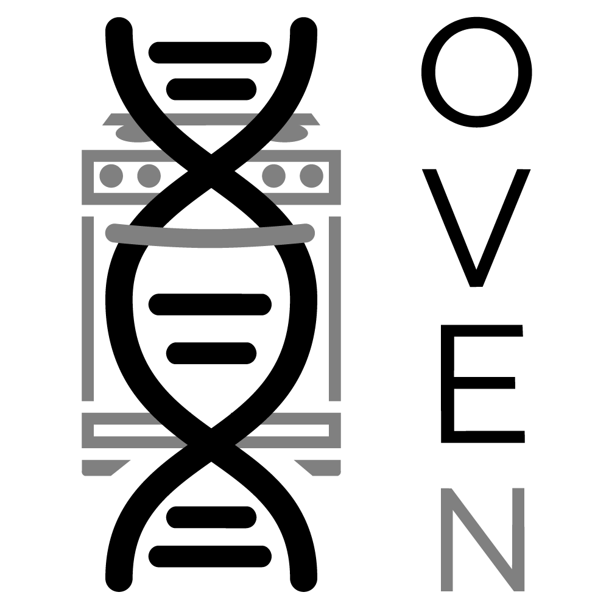

<p align="center">
  
</p>

<h1 align="center">OVEN — Open Vector Editor with New Features</h1>

<p align="center">
  A plasmid editor for VS Code, built on
  <a href="https://github.com/TeselaGen/tg-oss/tree/master/packages/ove">Open Vector Editor</a>.
</p>

Open `.gb`, `.gbk`, `.fasta`, `.fa`, `.faa`, `.dna` and `.ab1` files in a tab, then design primers,
collect them into an order, search your existing primer collection, search your whole map
library for a sequence, edit codons, and align Sanger reads against the plasmid on screen — or
proteins against a protein.


## Install

Search for **OVEN** in the Extensions view (`Cmd/Ctrl+Shift+X`), or:

```sh
code --install-extension gordonrix.oven
```

If you have `sanekun.openvectoreditor` installed, uninstall it first — otherwise both offer
to open `.gb` files.

<details>
<summary>Building it yourself</summary>

```sh
npm install
npm run package
code --install-extension oven-*.vsix --force
```

`npm run package` refuses to build if the vendored bundle has drifted from `patches/`.

`npm run screenshots` retakes the pictures in this README, full-screen for the display it
runs on. Nothing opens on screen: VS Code's own server runs this checkout, packaged, with a
throwaway profile and generated files, and headless Chrome draws it. Pass scene names to
retake only some; the options are at the top of `scripts/screenshots/run.mjs`.
</details>

## What this fork adds

Upstream is a viewer: it embeds Open Vector Editor in a VS Code tab and saves the file back.
Added here:

- **Primer cart** — collect primers across plasmid files into one order, with sessions, CSV
  export and cross-referencing against primers you already own
- **Primer search** over your own primer collection, 3′-anchored, with attach-to-sequence
- **Sequence search** across folders of maps — nucleotide or amino acid, exact or fuzzy,
  all six reading frames
- **New Primer as a side panel**, with an editable 5′ tail and mismatches marked in red
- **Sanger alignment** against the open plasmid, with chromatograms, translated mutated
  codons, and origin-spanning reads handled
- **Alignments save and reopen** as Stockholm files, coming back with the reads' own
  features and traces because the file records where every sequence came from
- **Protein alignment** — open a protein FASTA and align other proteins to it, with each
  difference marked residue by residue
- **`.ab1` files open directly**, so you can look at a trace without aligning it to anything
- **Change Amino Acid** — any codon, not just synonyms, with codon usage tables
- **Keyboard shortcuts** for primer search, new primer and the copy variants — see
  [Keyboard shortcuts](#keyboard-shortcuts)
- **Melting temperature and GC** for the current selection, in the status bar
- **Saving works as it does for any file** — `Cmd/Ctrl+S`, the unsaved dot on the tab, the
  prompt on closing, Save All and hot exit
- **DNA base editing enabled**, and the **Create** menu populated — upstream left OVE's
  `readOnly` default in place, which hid every item in it
- **Sequences open split**, sequence on the left and the circular map in a tab on the right
- **Persistent UI state** — View settings, cut-site filter, search columns and widths,
  codon-table organism

Plus fixes to Open Vector Editor itself: origin-spanning features corrupting on save, three
`.ab1` parser bugs, chromatogram scaling, and short annotation labels never being drawn.

The vendored OVE bundle is patched rather than forked, and every patch is tracked and
checksummed — see [`patches/README.md`](patches/README.md). Patches and issue drafts for
upstream are in [`upstream/`](upstream/).

## Primer cart

Collect primers across plasmid files into one list you can paste into an oligo order.


1. Highlight a region and use **Create → New Primer** — the menu bar, the right-click menu,
   or `Cmd/Ctrl+Shift+K`. It opens as a panel beside the sequence; **Set From Selection**
   fills in the binding site on the strand the **Strand** radio names.

   Type on the front of the **Bases** box to add a **5′ tail**; bases that do not match the
   template turn red. The annotation covers the annealing footprint only, but the full
   sequence goes to the cart and the file.
2. **Add to Cart** picks up any primer; ones you create are added automatically.
3. The cart is global across files and survives restarts.
4. **Copy** puts names and sequences on the clipboard; **Export CSV** writes the full table.

**Sessions** keep separate orders apart — see **OVEN: New Cart Session** and **OVEN: Switch
or Manage Cart Sessions**.

## Your primer inventory

Point `oven.inventoryPath` at a spreadsheet of primers you have already ordered and the
cart marks each one: green if you already have it (with its ID), orange if it is new.

**The file needs a name column and a sequence column**; everything else is up to you.
`.xlsx`, `.xlsm`, `.csv`, `.tsv` and `.txt` all work.

| setting | names | default |
|---|---|---|
| `oven.inventoryNameColumn` | the name or ID column | first column |
| `oven.inventorySequenceColumn` | the sequence column | second column |
| `oven.inventorySheet` | which sheet of a workbook | first sheet |
| `oven.inventoryAliasColumn` | an optional second identifier | a column named `Alias` |

Columns you do not name are still read, and offered in the search results under
**Columns**. Header matching is exact first, then case-insensitive.

## Primer search

Click **Primer Search**, or right-click the sequence, to find every primer in your
inventory that binds the open plasmid. Clicking a row scrolls to that site.

| Pos | Str | Name | Tm | Anneal bp | Tail bp | Alias | |
|---|---|---|---|---|---|---|---|
| 325 | + | P_0048 | 72.4 | 25 | — | fwd screen | Attach |
| 1522 | + | P_0123 | 65.4 | 22 | +16 | gibson fwd | Attach |

Matching is exact and **3′-anchored**, so tailed primers are found; the unmatched tail
shows in **Tail bp**, and **100% match** hides them. The search can be scoped to a
selection.

**Attach** adds a `primer_bind` annotation over the annealing footprint, keeping the full
sequence in a `/Sequence` qualifier; press **Save** to write it to the file. Cmd+Z will not
undo it — remove it from Properties → Primers.

### Choosing columns

**Columns** in the toolbar picks what the table shows: the computed `Tm`, `Anneal bp` and
`Tail bp`, plus any column of your inventory file. `Pos`, `Str`, `Name` and **Attach** are
always shown.

Your choice is remembered across files; **Reset to defaults** puts it back. Drag a divider
to resize a column, double-click one to reset all widths. Click a header to sort.

The **Filter** box searches names, sequences and the columns you are showing.

Other settings: `oven.searchMinAnneal` (default 15), `oven.searchFullLengthOnly`,
`oven.searchMaxHits`.

## Sequence search

Click **Sequence Search** to find a nucleotide or amino acid sequence across folders of maps
— the reverse of primer search, which works on the one plasmid you have open.


Add folders with **Browse…**, or drop them on the panel holding **⇧ Shift**. Files are
refused; this takes folders. Each gets a chip with a tickbox for searching subfolders, and
the list is remembered between sessions.

```
Constructs  and subfolders  817 files
```

Only `.gb` and `.gbk` are searched. Bases are read straight from the `ORIGIN` block rather
than parsed, so 2,900 files index in under half a second.

**Nucleotide or Amino acid**, and **Exact or Fuzzy**, which adds an identity threshold. An amino
acid query is searched against all six reading frames; hits come back in nucleotide
coordinates with the frame named, so clicking one opens the file with the right bases
selected. A file opened this way shows the sequence alone rather than the usual split — a
circular map cannot show you where a 33 bp hit is. Opening it any other way still follows
`oven.viewType`.

| Name | Pos | % ID | Length bp | Str |
|---|---|---|---|---|
| pUC19.gb | 1204..1236 | 100% | 33 | + |
| pGR-004.gb | 881..913 | 97.0% | 33 | − |

Hits are ranked by matches minus mismatches, so a long near-perfect match sits above a short
exact one. **Click a column to sort by it** — a second click reverses, a third goes back to
the ranking. The **Filter** box narrows the list by name or folder.

A hit must also cover at least **half the query** — every 11-mer occurs many times over in a
megabase target, and without that floor a 33 bp search against a genome buries the answer
under incidental fragments at 100% identity.

Indels are not spanned: a match containing one comes back as two adjacent hits.

## Alignment

Click **Align** in an open plasmid to check clones against it. It aligns against the plasmid as
last saved: save your edits first, or the panel will remind you they are not included. `.ab1`, `.gb`, `.gbk` and
`.fasta` reads are all accepted; a multi-record FASTA becomes one track per record.


Five ways to add reads (`.faa` counts too, for proteins):

- **Right-click the files in the Explorer → Add to Alignment** (handles a multi-selection)
- **Browse…** in the panel
- **Paste** — copy in Finder, click the panel, `Cmd+V`
- **Drag an open editor tab** onto the panel — a `.gb`, `.gbk`, `.ab1`, `.fasta` or `.dna`
  file you already have open becomes a read
- **Drag and drop** onto the panel, **holding ⇧ Shift**
- **Type or paste sequences** into the table under the drop zone: a name (optional;
  unnamed ones become `sequence1`, `sequence2`…) and the bases. Paste a block of rows
  copied from Excel or Google Sheets and it fills the table, a row per sequence; the
  sequence column is found whichever side it is on, and a header row is skipped. FASTA works
  too. A single column pasted into the **Name** or **Sequence** column fills just that column,
  from the row you pasted into, so names and sequences can be pasted separately in either
  order. **Add** takes them all at once. Any row that cannot be
  added stays in the table with the reason, and the rest go in. Whitespace and digits are
  ignored, so a numbered block pastes straight in

> Shift matters: without it VS Code opens what you drop as a new tab instead.

The reference sits pinned along the top, each read gets a row with its chromatogram, and
mutated codons show the amino acid they now encode.

Each read gets a verdict:

| | meaning |
|---|---|
| **match** (green) | perfect, and covers the reference end to end |
| **partial match** (gold) | perfect over the window it covers, but only part of the reference |
| **mismatch** (red) | something differs |

Hover a read for its counts, identity, strand and rotation. **Remove all**, beside the list of
sequences, clears them in one go, after asking, since the alignment goes with them.

**A read from a `.gb` or `.gbk` file brings its own annotations**, drawn on its own track and
put through the same flip and reorder as its sequence. **Query Annotations** in the eye menu
says whether the reads draw whatever the reference is drawing, so the two can be shown
separately without a tickbox per annotation type.

The chromatogram controls are greyed out when no `.ab1` is in the alignment, since there is
no trace for them to act on.

**Reads that cross the origin are handled**, and the reference is never rotated, so its
coordinates hold.

Trace ends below `oven.alignTrimQuality` (default 20) are trimmed before aligning; set it to
`0` to align the full read. `oven.alignMaxReads` (default 50) caps one alignment.

**Settings** under the Align button changes the main ones without leaving the panel: the
MAFFT strategy (Auto, Accurate L-INS-i, Fast FFT-NS-1, or your own arguments), the gap
opening and extension penalties, and the trace trim quality. They are the same
`oven.mafftArgs` and `oven.alignTrimQuality` settings, so every open alignment uses them, and
they take effect the next time you press **Align**. Changing the trim quality re-trims reads
already in the panel, too. A saved alignment records the arguments it was actually made
with.

### Protein alignment

Open a protein FASTA (`.fa`, `.fasta` or `.faa`) and it opens as a protein: Open Vector
Editor's protein view, with residues, numbering and a length in AAs. Press **Align** and add
other proteins the same ways as reads.


Whether a file holds DNA or protein is read from its letters, so a protein saved as `.fasta`
is recognised; `.faa` is always a protein.

Proteins align to proteins only. A DNA read added against a protein reference stays in the
list with a red note saying so and is left out of the alignment, and the same goes the other
way round. Change the reference and the notes are worked out again.

Residues are drawn as letters, and every residue that differs from the reference is marked
in red, as bases are. A protein that differs shows **how** identical it is — `98.3%
identical` — rather than a bare *mismatch*: two related proteins are never the same, and how
far apart they are is the thing to read. A gap counts against that figure, so a protein
missing three residues is not shown as 100%. **match** and **partial match** mean what they
do for DNA, and a partial match needs at least 24 residues. That is the same odds of a chance
match as the 50 bases asked of DNA, since each residue is one letter of twenty rather than
four.

Nothing DNA-specific applies to a protein — no traces, strands, rotations or origin. The
DNA-only tools are left out of a protein's editor too: primers, the cart, cut sites, codon
edits and Sequence Search. A protein's own features are not drawn on its alignment track
yet. A saved protein alignment reopens as one.

### Saving an alignment

**Save…** writes the alignment to a `.sto` file, and double-clicking that file opens it here
again — the same tracks, with the reads' features, their chromatograms and the reference's
annotations. You are offered the folders the reference and the reads came from, since that is
usually where it belongs; **Choose another folder…** opens the ordinary save dialog. The name
it suggests is dated — `2026-09-23_alignment.sto` — so a folder of them sorts by when they
were made; reopening one and saving again suggests its own name instead.

It reopens as the alignment you saved rather than a fresh one: the columns are in the file, so
nothing is realigned and MAFFT is not needed to look at it. A sequence you typed or pasted in
has no file to be re-read from, so the alignment file carries its bases itself. A file dragged
or pasted in from Finder arrives without its path, so OVEN looks for it: below the folder you
save to and the one above it, and in your workspace, taking a file only if its contents are the
ones you added — so the traces of a sequencing order unpacked next to the alignment come back.
Alignments saved before this find their files the same way when they are reopened. What is re-read from disk is the
sequences themselves, which is where the features and the traces live — a file that has moved
with the alignment, or alongside it, is found either way. If a source has been edited or is
missing, the alignment still opens on the bases held in the file and says which tracks lost
their annotations. Pressing **Align** on a reopened alignment realigns it from scratch.

The file is [Stockholm](https://en.wikipedia.org/wiki/Stockholm_format), which HMMER,
Biopython, EMBOSS and Jalview all read, so an alignment saved here is not stuck here. What
OVEN adds are `#=GS` lines naming each row's source file, strand and coverage — annotation
lines the format sets aside for exactly this, and which other tools skip over.

### MAFFT

Alignment needs MAFFT, installed separately:

```bash
brew install mafft                      # macOS
sudo apt install mafft                  # Linux
conda install -c bioconda mafft         # macOS or Linux
```

On Windows, download MAFFT's [all-in-one package](https://mafft.cbrc.jp/alignment/software/windows_without_cygwin.html)
and unzip it. OVEN finds it in your home folder, Downloads, Desktop or Documents, or you can
point it at the `mafft.bat` inside. MAFFT installed in WSL (`sudo apt install mafft` in
Ubuntu) works too, and is the faster of the two.

If it is missing, the panel says so when it opens and offers a **Locate MAFFT…** button
and **Re-check**.

Elsewhere, OVEN looks on your `PATH`, then where Homebrew and conda install — including named conda
environments, the usual reason a `mafft` that works in the terminal is invisible here. **VS
Code reads your `PATH` at startup**, so installing MAFFT with the editor open needs a window
reload.

Run **OVEN: Check MAFFT Installation** to see which binary was found. `oven.mafftPath` sets
one explicitly; `oven.mafftArgs` (default `--auto`) passes your own strategy.
`--adjustdirection` is added for DNA. A protein gets `--amino` instead, placed after your own
arguments so it wins.

## Editing

**Change Amino Acid** — right-click a residue in a translation and pick any codon in the
genetic code, not just that residue's synonyms.


It is laid out the way a codon table is printed, and every codon carries its **fraction**
(share of that amino acid's codons) and **frequency** (per thousand), for *S. cerevisiae*,
*E. coli*, *H. sapiens* and *M. musculus* — from the Codon Usage Database (Nakamura et al.
2000).

Set `oven.allowSequenceEditing` to `false` to lock the bases, or `oven.readOnly` to lock the
file entirely.

## Selection readout

Selecting a region gives you, in one line:

```
DNA | Editable | Selecting 22 bps from 101 to 122 (45.5% GC) | Melting Temp: 64.5 | Length: 6537 bps
```

Melting temperature uses SantaLucia (1998) by default, as NEB's calculator does; click the
readout to switch to Breslauer. Outside **8–100 bp** it shows `—`.

`oven.showSelectionStatsByDefault` (on) switches both status-bar items on the first time you
open a sequence; toggling them yourself in the **View** menu always wins.

## Other

- **`.ab1` traces** open with the chromatogram on, and are read-only — there is no writer
- Select a DNA file → **Open With → OVEN**, and set it as the default if you like
- Sequences open with a **whole-sequence map** in a tab on the right, beside the sequence:
  the **Circular Map** for a circular sequence, the **Linear Map** for a linear one. A linear
  sequence gets no Circular Map tab at all — Open Vector Editor only draws it there to warn
  you off it. A circular sequence keeps both. `oven.viewType` changes the layout:
  `sequence` or `circular` for a single pane with the rest as tabs you switch to.
  **Reopen the file** for a change to take effect
- Save with **File → Save** or `cmd/ctrl+S`, in every format including `.dna`. Unsaved edits
  put the usual dot on the tab, and VS Code asks before closing the file or quitting, as it
  does for any other file. **Save All**, **Revert File** and VS Code's hot exit, which keeps
  unsaved changes across a restart, work too
- **Copy carries annotations.** Copy a stretch of sequence and paste it into another plasmid
  and its features, parts and primers come with it. **Edit → Copy Options** chooses whether
  partial ones are included. Pasting into anything else still gives plain bases
- **Filter Cut Sites**, and the **View** settings for how a sequence is drawn, are remembered
  between files rather than resetting each time: Amino Acid Numbers, Axis and Axis Numbers,
  ORFs and ORF Translations, CDS Feature Translations, Reverse Sequence, 5′ 3′ Hints, DNA
  Colors, and which kinds of labels are shown. What a file holds (features, parts,
  primers, cut sites, its own translations) is still shown or hidden per file, so hiding
  one in one plasmid never makes it look absent in the next
- **Find** (`cmd/ctrl+F`) takes a number of **Mismatches**, 0 by default, so a primer with a
  base or two wrong still finds its site. **DNA** and **AA** sit beside it, one click either
  way, to search the bases or the translation. Cmd/Ctrl+Z undoes what was typed or pasted
  into it, as in any text box
- Search hits are marked with a dark grey bar showing which strand they matched
- **OVEN: Open Demo Editor** opens an empty editor to try things in, backed by no file

## Keyboard shortcuts

The ones this fork adds. **View → View Editor Hotkeys** lists these alongside Open Vector
Editor's own.

| | | |
|---|---|---|
| `⌘⌥F` | `Ctrl+Alt+F` | **Primer Search** — the selection if there is one, the whole plasmid otherwise |
| `⌘⌥L` | `Ctrl+Alt+L` | **Align** |
| `⌘⌥K` | `Ctrl+Alt+K` | **Primer Cart** |
| `⌘⇧K` | `Ctrl+Shift+K` | **New Primer** |
| `⌘L` | `Ctrl+L` | **New Translation** of the selection |
| `⌘⇧L` | `Ctrl+Shift+L` | **New Reverse Translation** of the selection |
| `⌘⇧R` | `Ctrl+Shift+R` | Copy Reverse Complement |
| `⌘⌥A` | `Ctrl+Alt+A` | Copy AA Sequence |
| `⌘⌥E` | `Ctrl+Alt+E` | Copy Reverse Complement AA Sequence |
| `⌘⌥P` | `Ctrl+Alt+P` | Simulate PCR |

Plain `⌘C` copies the selection.

Hovering a toolbar button shows its shortcut.

**Rebinding.** `oven.searchPrimersHotkey`, `oven.newPrimerHotkey`, `oven.alignHotkey` and
`oven.cartHotkey` take Open Vector
Editor's notation — `mod` is Cmd or Ctrl, joined with `+`, as in `mod+alt+n`. Empty means no
shortcut, and the file must be reopened.

Avoid anything VS Code binds at the workbench level, such as `mod+j` or `mod+shift+f`
(**Search: Find in Files**) — those never reach the editor, so the shortcut appears to do
nothing.

## Settings

Anything that reads like `oven.something` is a VS Code setting. Press **`Cmd/Ctrl+,`** and
type **OVEN**; they are grouped under **Extensions → OVEN**. To edit them as text, run
**Preferences: Open User Settings (JSON)** and add entries like:

```jsonc
{
  "oven.inventoryPath": "/Users/you/Documents/Primers Inventory.xlsx",
  "oven.newPrimerHotkey": "alt+p"
}
```

Most take effect immediately; the ones that change how the editor is built —
`oven.newPrimerHotkey`, `oven.searchPrimersHotkey`, `oven.alignHotkey`, `oven.cartHotkey`,
`oven.readOnly`, `oven.viewType` —
need the file reopened.

## Known issues

In protein alignments:

- Dragging a selection across residues still reads `Selecting N bps` in the status line.
- The eye menu still offers **DNA Colors**. Ticking it shades the residues A, C, G and T as
  if they were bases; leave it off.
- A protein GenBank whose `LOCUS` line does not say `aa` stores its features in residues
  rather than OVE's expected units, so they can be drawn in the wrong place in the editor.

Inherited from upstream:

- `.dna` files: primers already in the file are displayed and preserved on save, but **new**
  primers created in the UI are not written back. Use `.gb` if you need that. The primer cart
  is unaffected.

## Fork notice

This is a fork of [sanekun/ove-vscode](https://github.com/sanekun/ove-vscode), which is
licensed under **GPL-3.0**. This fork is also GPL-3.0; see [LICENSE](LICENSE).

It is based on upstream **v1.2.0**, which was published to the Marketplace but never
pushed to git, so those sources were imported from the published VSIX — see the
`vendor-1.2.0` tag, which records a sha256 for every imported file.

## Release notes

See [CHANGELOG.md](CHANGELOG.md).
